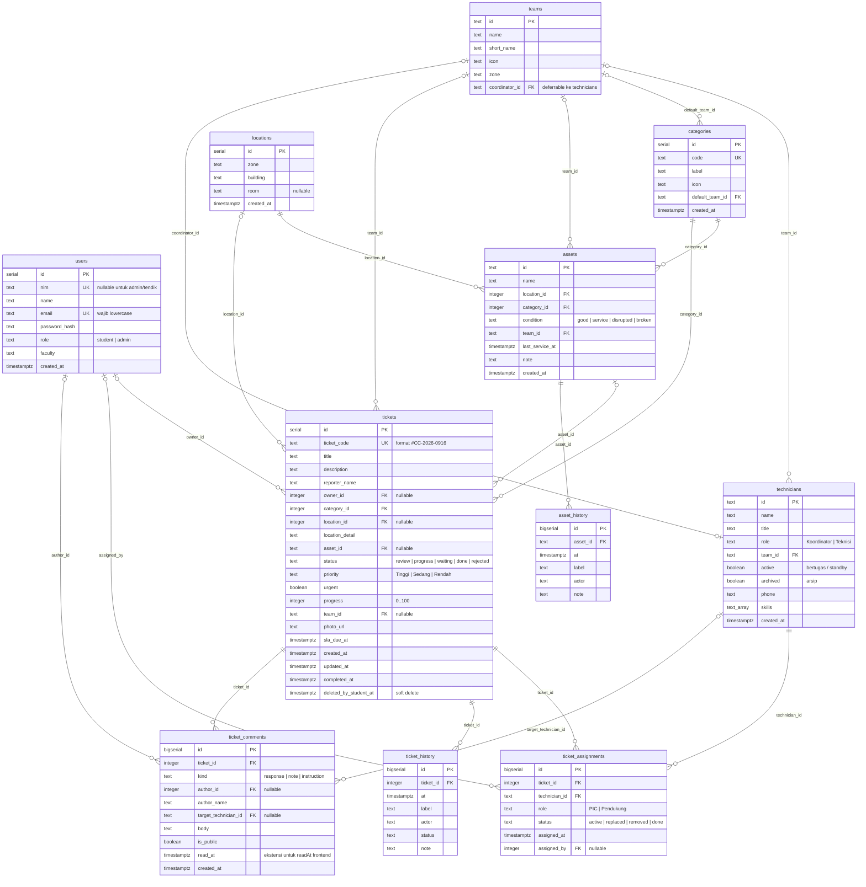

# ERD — CampusCare

Diagram relasi database PostgreSQL CampusCare. Sumber kebenaran skema ada di
[`backend/db/schema.sql`](../backend/db/schema.sql).

## Diagram

## Penjelasan relasi

### users → tickets
Satu mahasiswa/admin dapat memiliki banyak tiket. `tickets.owner_id` **nullable**
karena pelapor tendik/non-mahasiswa (mis. Satpam, Cleaning Service, BEM) tidak
punya akun. Identitas pelapor tetap disimpan di `tickets.reporter_name`.

### teams ↔ technicians
- `technicians.team_id` → `teams.id` (`ON DELETE SET NULL`). Satu tim punya
  banyak teknisi; satu teknisi berada di satu tim.
- `teams.coordinator_id` → `technicians.id` adalah **FK melingkar**. Karena itu
  kolom ini dibuat `DEFERRABLE INITIALLY DEFERRED`: tim boleh di-insert lebih
  dulu dengan koordinator `NULL`, teknisi dimasukkan, lalu koordinator di-update
  dalam transaksi yang sama.
- Teknisi tidak dihapus permanen jika sudah punya riwayat tiket. Frontend
  memakai `archived = true`; FK `ticket_assignments.technician_id` memakai
  `ON DELETE RESTRICT` agar riwayat tidak hilang.

### categories → tickets / assets
Satu kategori dipakai banyak tiket dan aset. `categories.default_team_id`
menunjuk tim yang biasanya menangani kategori tersebut (mis. `ac` → tim
`electrical`). Kategori tidak boleh dihapus jika masih dipakai
(`ON DELETE RESTRICT`).

### locations → tickets / assets
Satu lokasi dipakai banyak tiket dan aset. `locations` menggabungkan zona aset
(`FT`, `GKB`, `Perpustakaan`, `Rektorat`, `GOR`, `FIK`) dengan gedung formulir
(`Gedung A`–`Gedung F`). `room` nullable; `UNIQUE (building, room)` dilengkapi
unique index `COALESCE(room, '')` agar satu gedung hanya punya satu baris
level-gedung.

### assets → asset_history
Riwayat perawatan aset. `ON DELETE CASCADE`: jika aset benar-benar dihapus,
riwayatnya ikut terhapus. Tiket yang menunjuk aset memakai `ON DELETE SET NULL`
agar tiket tidak hilang saat aset dihapus.

### tickets → ticket_assignments
Satu tiket punya banyak penugasan (satu PIC + beberapa pendukung, plus riwayat
PIC lama). Aturan penting:
- Partial unique index `uq_ticket_assignments_active_pic` menjamin **maksimal
  satu PIC berstatus `active` per tiket**.
- Partial unique index `uq_ticket_assignments_active_tech` mencegah satu teknisi
  punya dua penugasan `active` pada tiket yang sama.
- `assigned_by` menunjuk user admin yang melakukan disposisi (nullable bila
  sistem/seed).

### tickets → ticket_history
Audit log/timeline status. Setiap perubahan status atau aksi penting sebaiknya
menambah baris di sini. Berbeda dari komentar: history untuk jejak audit,
komentar untuk diskusi/instruksi/catatan.

### tickets → ticket_comments
Komentar bertipe:
- `instruction`: instruksi admin ke teknisi tertentu (`target_technician_id`).
- `note`: catatan operasional internal.
- `response`: tanggapan yang boleh dilihat mahasiswa (`is_public = true`).

`read_at` adalah ekstensi kecil untuk memetakan field `readAt` pada instruksi
frontend. Kolom ini boleh `NULL`.

### Soft delete tiket
`tickets.deleted_by_student_at` diisi saat mahasiswa memilih "hapus riwayat".
Baris **tidak dihapus**; admin masih melihat tiket, sedangkan query mahasiswa
menambahkan `deleted_by_student_at IS NULL`.

## View

| View | Isi |
| --- | --- |
| `v_ticket_summary` | Tiket + label kategori, lokasi, tim, PIC, dan flag `is_overdue` (SLA lewat untuk tiket yang belum `done`/`rejected`). |
| `v_technician_workload` | Per teknisi: `active_ticket_count`, `done_ticket_count`, `total_ticket_count`. |

## ON DELETE

| FK | Perilaku | Alasan |
| --- | --- | --- |
| `tickets.owner_id` | `SET NULL` | Tiket tetap ada meski akun dihapus. |
| `tickets.category_id` | `RESTRICT` | Kategori yang dipakai tidak boleh hilang. |
| `tickets.location_id` | `SET NULL` | Tiket tetap ada meski lokasi dihapus. |
| `tickets.asset_id` | `SET NULL` | Tiket tetap ada meski aset dihapus. |
| `tickets.team_id` | `SET NULL` | Tiket tetap ada meski tim dibubarkan. |
| `ticket_assignments.ticket_id` | `CASCADE` | Penugasan milik tiket. |
| `ticket_assignments.technician_id` | `RESTRICT` | Riwayat teknisi harus utuh (pakai `archived`). |
| `ticket_history.ticket_id` | `CASCADE` | Audit milik tiket. |
| `ticket_comments.ticket_id` | `CASCADE` | Komentar milik tiket. |
| `asset_history.asset_id` | `CASCADE` | Riwayat milik aset. |
| `assets.location_id` | `RESTRICT` | Aset harus punya lokasi valid. |
| `assets.category_id` | `RESTRICT` | Aset harus punya kategori valid. |
| `teams.coordinator_id` | `SET NULL` | Tim tetap ada tanpa koordinator. |
